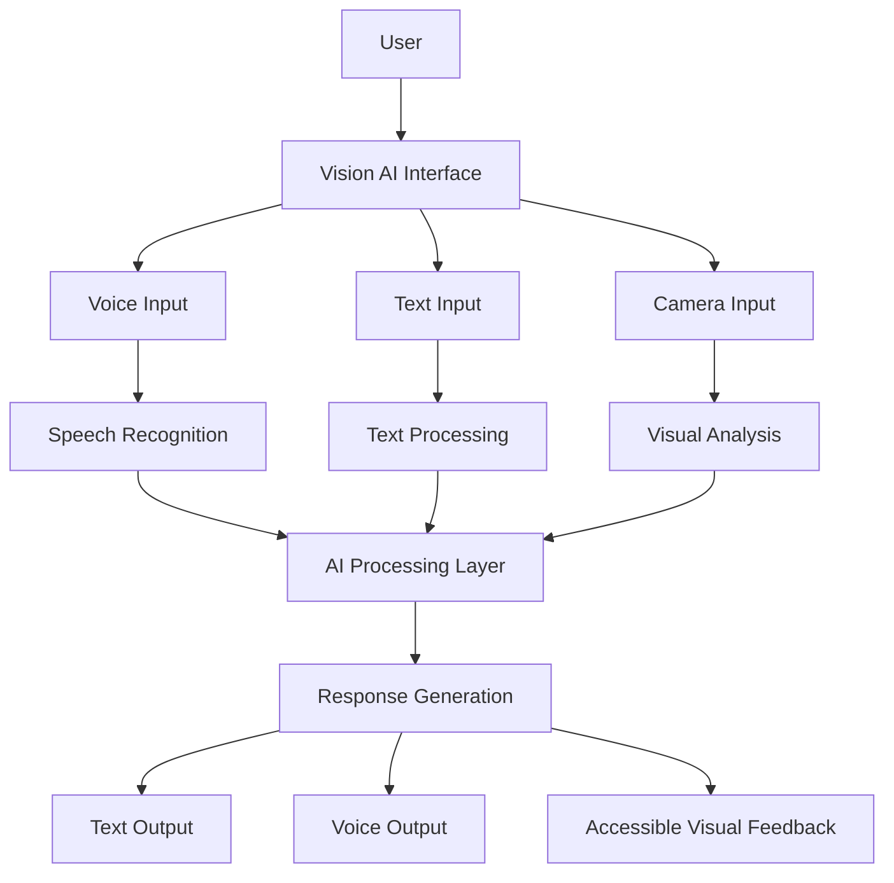

# 🌍 VISION AI
### One Platform. Every Ability. No Communication Barriers.

**See • Hear • Speak • Understand**

> Communication Without Barriers.

---

## 📌 About the Project

VISION AI is an AI-powered accessibility and inclusion platform designed to make technology and communication accessible to everyone, regardless of disability, language, or literacy level.

The platform aims to assist people who are blind or visually impaired, deaf or hard of hearing, speech-impaired, and color-blind through intelligent voice interaction, camera-based assistance, text processing, and accessible design.

Our vision is to create a world where technology adapts to people, not people to technology.

---

## 🎯 Mission

Our mission is to ensure that no person's disability, language, or literacy level becomes a barrier to communication.

VISION AI combines accessibility tools into one platform to help users see, hear, speak, understand, and interact more independently.

---

## ✨ Key Features

### 👁️ Visual Assistance
- Camera-based interaction.
- AI-powered visual understanding.
- Assistance for blind and visually impaired users.
- Voice feedback for recognized information.
- Voice-operated interaction without depending entirely on the screen.

### 🎙️ Voice Assistance
- Voice commands for hands-free interaction.
- Speech-to-Text (STT).
- Text-to-Speech (TTS).
- Audio feedback on button clicks and actions.
- Voice-guided navigation.

### 🧏 Communication Assistance
- Text-based communication support.
- Speech-to-text functionality for hearing accessibility.
- Text-to-speech for users with speech difficulties.
- Language translation support.

### 🎨 Color Accessibility
- Color-blind-friendly interface.
- Improved contrast and readability.
- Color-independent icons and labels.
- Accessible visual elements.

### 🌐 Language Support
- Multilingual interaction.
- Translation assistance.
- Voice and text-based communication.

### 🌓 UI & Accessibility
- Light Mode and Dark Mode.
- Responsive design for mobile, tablet, and desktop.
- Accessible header and footer.
- Clear navigation and interface elements.
- Accessibility-focused interaction design.

---

## 🛠️ Tech Stack

| Technology | Purpose |
|---|---|
| HTML5 | Semantic structure and web content |
| CSS3 | Styling, layouts, animations and responsive design |
| JavaScript (ES6+) | Application logic and interactivity |
| React.js | Component-based UI (if implemented) |
| Vite | Development server and build tool (if implemented) |
| Web Speech API | Speech recognition and speech synthesis (if implemented) |
| MediaDevices API | Camera and microphone access |
| AI APIs | Intelligent processing and AI-powered assistance |
| Translation APIs | Multilingual communication |
| Git | Version control |
| GitHub | Source code hosting and collaboration |
| VS Code | Development environment |
| npm | Package and dependency management |

---

## 🧠 How VISION AI Works

1. **User Input** – Users interact through voice, text, or camera.
2. **Input Processing** – The platform processes the captured input.
3. **AI Processing** – The relevant AI or accessibility service analyzes the information.
4. **Response Generation** – The system generates understandable results.
5. **Accessible Output** – Results are delivered through text, audio, or visual feedback.
6. **User Interaction** – Users can continue interacting through accessible input methods.

---

## 🏗️ System Architecture



---

## ♿ Accessibility & Inclusion

VISION AI is designed with accessibility and inclusive interaction in mind.

- **Blind and visually impaired users:** Voice guidance, spoken feedback, and voice-based interaction.
- **Deaf and hard-of-hearing users:** Text-based information and speech transcription.
- **Speech-impaired users:** Typed communication and text-to-speech output.
- **Color-blind users:** Contrast-friendly interface, labels, icons, and distinguishable elements.
- **Multilingual users:** Translation and language-support features.
- **Different literacy levels:** Simple interface and understandable communication.

---

## 📷 Camera & Voice Interaction

VISION AI uses browser-based device capabilities where supported.

- Camera access for visual input.
- Microphone access for voice input.
- Voice announcements for user actions.
- Spoken responses for accessibility.
- Permission-based access to camera and microphone.

Camera and microphone access require user permission and may require HTTPS or localhost.

---

## ⚙️ Installation & Setup

### 1. Clone the repository

```bash
git clone https://github.com/YOUR-USERNAME/VISION-AI.git
```

### 2. Navigate to the project folder

```bash
cd VISION-AI
```

### 3. Install dependencies

```bash
npm install
```

### 4. Configure environment variables

Create a `.env` file in the root directory if your project requires API credentials.

```env
